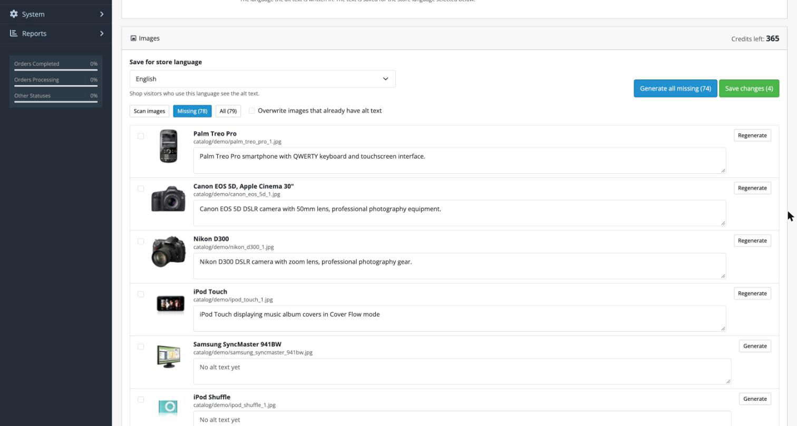
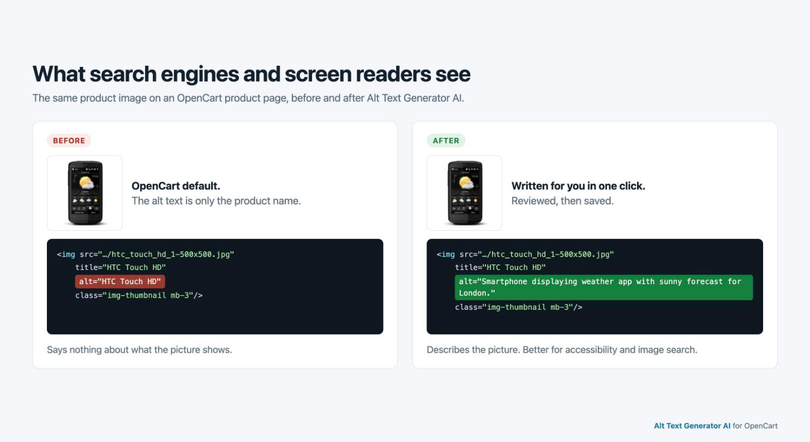
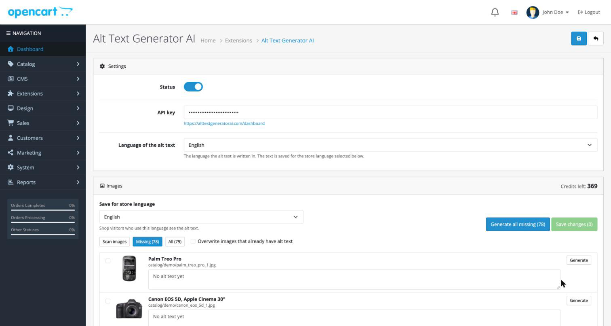
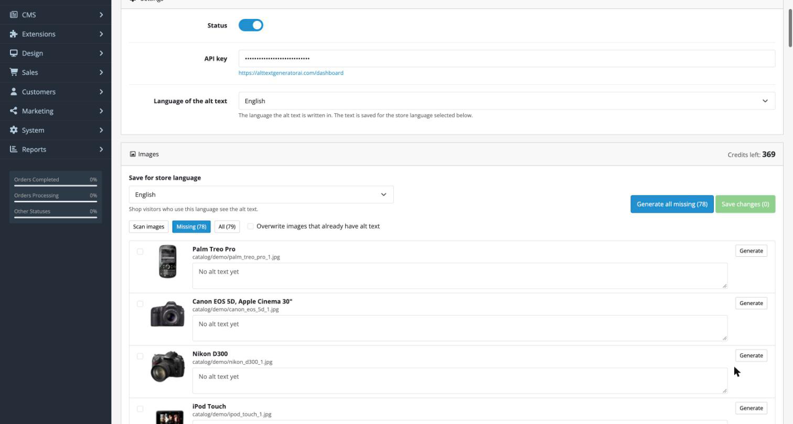

# Alt Text Generator AI for OpenCart


Write SEO-friendly alt text for the images in your OpenCart shop. Generate it for one image, for a selection or for every image that is missing it, review it, and save it. Your storefront then uses it as the `alt` attribute. 131 languages.

[Get a free API key](https://alttextgeneratorai.com/dashboard)





## What you get

- **A bulk page.** An **Alt Text Generator AI** page under **Catalog** scans the images used by your products, categories, brands and banners, shows thumbnails, lists the ones without alt text, and generates it for all of them or only the ones you tick.
- **Review before saving.** Edit any text, then save everything at once.
- **Works with your theme.** OpenCart has no alt field for images and uses the product name as the alt text. The extension keeps its own list and puts the alt text into the images of your storefront, on product pages, listings and category pages, with no theme changes. It has been tested on OpenCart's default theme and on third-party themes. Images without alt text keep OpenCart's default.
- **131 languages.** Choose the language the alt text is written in, and the store language it is saved for.
- **Credits shown in the admin.** One credit writes alt text for one image. New accounts get free credits.
- **Your key stays on your server.** The API key is only used by the extension's server code and never reaches the browser.

## Requirements

- OpenCart 4.0.2.0 to 4.1.0.4 (all nine versions in that range tested), or OpenCart 3.0.2 and newer (tested on 3.0.5.1 and 3.0.3.8)
- PHP with the GD and cURL extensions, which OpenCart already uses
- An Alt Text Generator API key ([get one free](https://alttextgeneratorai.com/dashboard))

## Install

Download the file for your OpenCart version from the [releases page](https://github.com/balt1794/opencart-extension-alt-text-generator/releases):

| Your OpenCart | File |
| --- | --- |
| 4.x | `altai.ocmod.zip` |
| 3.x | `altai_oc3.ocmod.zip` |

**OpenCart 4**

1. Open **Extensions > Installer**, upload `altai.ocmod.zip` and click the green **Install** button.
2. Open **Extensions > Extensions**, choose **Modules** in the list, find **Alt Text Generator AI** and click the green **+** to install it, then the blue pencil to open it.
3. Paste your API key, check that **Status** is on and click **Save**.

**OpenCart 3**

1. Open **Extensions > Installer** and upload `altai_oc3.ocmod.zip`. Click the green **Install** button next to it.
2. Open **Extensions > Extensions**, choose **Modules** in the list, find **Alt Text Generator AI** and click the green **+** to install it, then the blue pencil to open it.
3. Paste your API key, set **Status** to **Enabled** and click the blue save button.

Both versions work the same way from here on.



## Use it

1. Open **Catalog > Alt Text Generator AI**. It scans your images and shows your credits.
2. **Missing** lists the images with no alt text. **All** shows everything.
3. Tick the images you want, or leave them all unticked.
4. Click **Generate selected** or **Generate all missing**. Each image uses 1 credit.
5. Read the results, change anything you like, then click **Save changes**.

**Generate all missing** skips images that already have alt text. Tick an image to generate it anyway, or tick **Overwrite images that already have alt text**.



### Languages

**Language of the alt text** is the language the text is written in. **Save for store language** is the shop language whose visitors see it. If your shop has several languages, generate and save once for each.

## Themes

The extension changes the finished HTML of your pages, not your theme files, so it works with custom themes. It has been tested on OpenCart's default theme and on third-party themes. It finds an image by its address, including resized copies in `image/cache` and lazy-loading themes that keep the address in `data-src`. If a theme loads images in a way that hides their address, or builds them in JavaScript, the alt text cannot be added there.

## Tests

```sh
php tests/rewrite_test.php      # OpenCart 4
php tests/rewrite_test_oc3.php  # OpenCart 3
```

## Uninstall

Removing the extension switches the alt text off in your storefront and keeps the alt texts you wrote, so installing it again brings them back. OpenCart removes the extension's settings, including the API key, so add the key again after installing.

## Privacy

When you generate alt text, a resized copy of the image (JPEG, up to 1024 px) and your API key are sent from your server to `alttextgeneratorai.com`. Images are not stored. Nothing is sent from the browser.

## Troubleshooting

| What you see | What to do |
| --- | --- |
| "Add your API key" notice | Paste the key in the settings and click **Save**. |
| "Invalid API key" | Copy the key again from your [dashboard](https://alttextgeneratorai.com/dashboard). |
| "No credits left on this API key" | Add credits at [alttextgeneratorai.com](https://alttextgeneratorai.com). |
| The page is not in the Catalog menu | Make sure the module is installed and refresh the admin. You can always open it from Extensions > Extensions > Modules. |
| Alt text does not show on the storefront | Check **Status** is on, and clear the theme cache under **Dashboard > Developer settings** (OpenCart 3: the blue gear on the dashboard). |

## Support

support@alttextgeneratorai.com

## License

[MIT](LICENSE) © Bryam Loaiza
